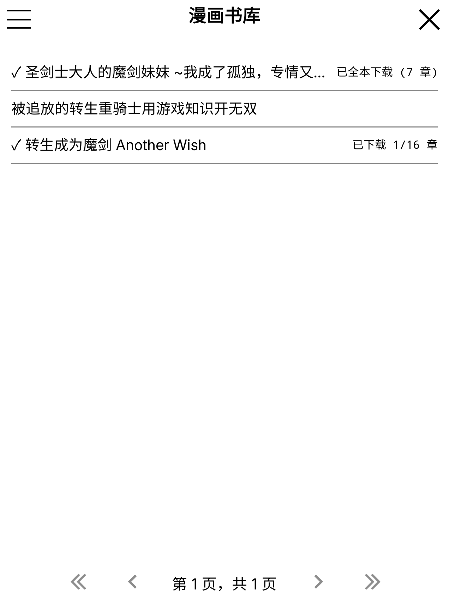
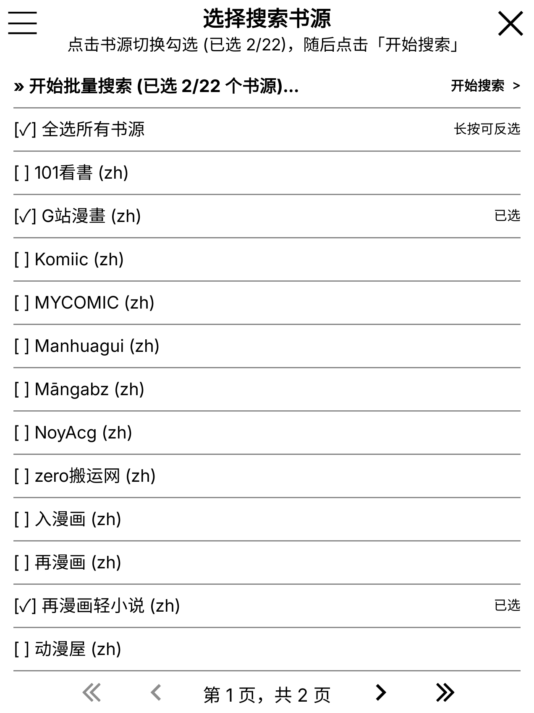
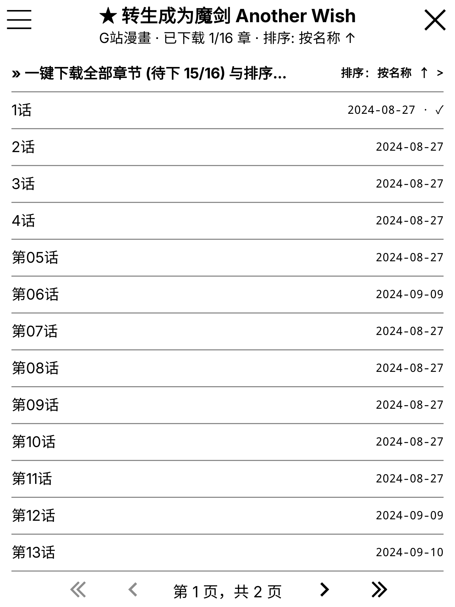
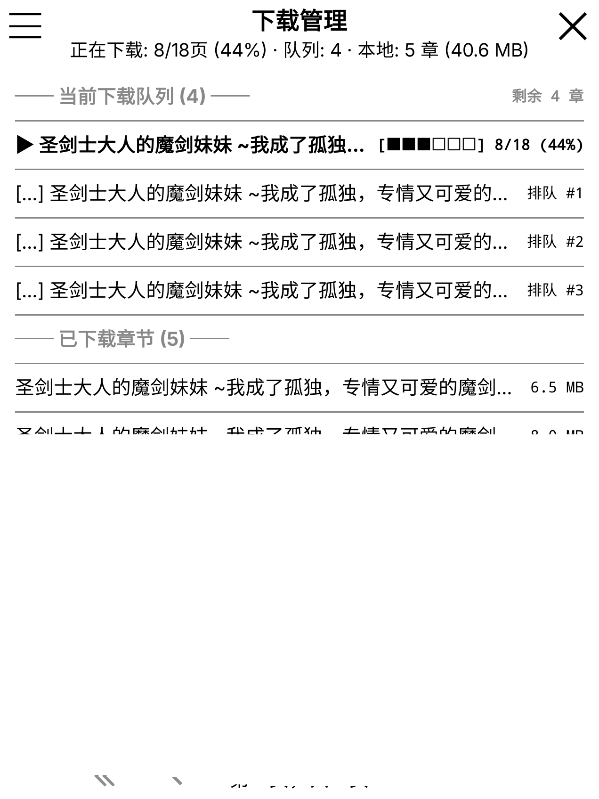

# Tsundoku (積読)

> *「積読 (Tsundoku)」—— 把喜欢的漫画一口气囤进墨水屏里，随时随地离线慢慢看。*

**Tsundoku** 是一款专为 **KOReader**（Kindle / Kobo 等电子墨水屏阅读器及桌面端 Linux）打造的增强型漫画管理插件与纯 Go 书源运行时后端。

本项目基于 **[ohaiibuzzle/aidoku-backend-0.7](https://github.com/ohaiibuzzle/aidoku-backend-0.7)** 深度扩展开发，底层完整兼容 **[Aidoku](https://github.com/Aidoku/Aidoku)**（[aidoku.app](https://aidoku.app) / **[AidokuRunner](https://github.com/Aidoku/AidokuRunner)**）的 `0.7` 版 `.aix` 漫画书源生态（WASM + QuickJS，零 CGO 纯 Go 实现），在无需 iOS / Swift 环境的前提下，为墨水屏设备提供流畅的跨源追漫与全本囤漫体验。

---

## 致谢与上游引用 (Credits & Upstream)

本项目的诞生离不开以下优秀开源项目与社区的工作，特此致谢：

- **[Aidoku](https://github.com/Aidoku/Aidoku)**（官网：[aidoku.app](https://aidoku.app)）与 **[Aidoku/AidokuRunner](https://github.com/Aidoku/AidokuRunner)**：定义了优秀的 `.aix`（WebAssembly + 配置清单）模块化漫画书源格式与宿主运行时规范。
- **[ohaiibuzzle/aidoku-backend-0.7](https://github.com/ohaiibuzzle/aidoku-backend-0.7)**：本项目直接基于的上游仓库，使用纯 Go（`wazero` + QuickJS WASM）重实现了 AidokuRunner `0.7` 运行时并提供了初代 KOReader 插件框架。
- **[Aidoku Community Sources](https://github.com/Aidoku-Community/sources)**：社区维护的丰富多语言漫画书源仓库生态。

> 声明：本项目为独立开源衍生项目，与 Aidoku 官方团队无隶属或背书关系。

---

## 核心特性 (Features)

<p align="center">
  
  
  
</p>
<p align="center">
  
  
  
</p>

### 相比基础版的核心增强
- **下载管理中心 (Download Manager)**：
  - 基于非阻塞后台队列（`downloadqueue.lua`），下载过程不阻塞书库浏览、搜索或阅读，并自动托管设备防休眠锁。
  - **实时页级进度展示**：解析后台 `aidoku-run` 页级下载流，在电子墨水屏上通过低闪烁局部刷新展示分段进度条（如 `[■■■□□□] 8/18 (44%)`）、排队状态与本地已占空间。
  - 支持 **暂停/恢复下载队列**、**优先插队下载**、**取消单个/全部待下任务**、**失败任务一键重试**，以及 **按章节平铺 / 按漫画整本聚合** 双视图切换。
- **多书源搜索 Plus (Multi-source Search Plus)**：
  - 搜索前支持自由勾选/取消目标书源（支持全选、清空、长按反选、长按单源独立搜索），书源选择范围自动持久化记忆，随后的批量搜索仅在选定书源中高效执行。
  - 新增 `aidoku-run - manifests <sources-dir>` 批量清单扫描与内存缓存，安装数十个书源时依然秒开。
- **一键全本批量下载与全局已下载标注 (Batch Download & Offline Badges)**：
  - 支持在漫画详情页或书库长按菜单中 **一键下载整本漫画所有章节**（自动跳过已下载章节、按阅读顺序排队，并通过 `download-payload` 免去逐章重复请求详情的网络开销），亦支持「下载后续 N 章」与「从本章起向后批量下载」。
  - 在 **漫画书库**、**多书源搜索结果**、**单源搜索结果** 与 **下载管理** 中全局标注已下载书籍，清晰区分 `✓ 已全本下载 (N 章)` 与 `✓ 已下载 M/N 章`。
- **多维章节排序 (Flexible Chapter Sorting)**：
  - 支持 **默认顺序（最新/最早章节优先）**、**按章节名称排序（自然数字感知正序 A → Z / 倒序 Z → A，正确排列 `第2话 < 第10话`）** 以及 **按更新时间排序（最近更新 / 最早更新优先，精确展示上传时间）**。
- **完整多语言国际化支持 (Full i18n: English / 中文 / 日本語)**：
  - 100% 覆盖 **英语 (`en`)**、**中文（简体 `zh_CN` / 繁体 `zh_TW`）** 与 **日语 (`ja`)** 三套界面语言。
  - 默认自动跟随 KOReader 系统语言，同时支持在插件「设置 → 界面语言 (`Language` / `表示言語`)」中**免重启实时切换**语言（独立词典隔离，不污染 KOReader 宿主翻译）。
- **多形态书库视图与原生阅读体验**：
  - 书库支持 **精简列表 / 图文列表 / 封面网格** 三种视图切换与异步封面缩略图缓存。
  - 章节自动打包为内含 `ComicInfo.xml` 元数据的 `.cbz` 归档，阅读到底部支持自动翻入下一章、后台静默预加载后续章节、临时内存盘模式（Ephemeral Mode）以及 FlareSolverr / Cookie 导入过盾。

---

## 安装指南 (Installation)

1. 从 [Releases](https://github.com/anyin233/tsundoku/releases) 下载对应设备架构的插件包（或自行编译后复制 [`koreader/aidoku.koplugin`](koreader/aidoku.koplugin)）：
   - Kindle Paperwhite 2+ / Voyage / Oasis / PW5 / PW6、主流 Kobo 设备：`armv7`
   - 早期 Kindle（Kindle 4 / Touch / PW1）：`armv6`
   - 64 位 ARM 设备 / Linux ARM64：`arm64`
   - Linux x86_64 桌面端：`x64`
2. 将解压后的 `aidoku.koplugin` 文件夹放入 KOReader 的 `plugins/` 目录（例如 Kindle 上的 `/mnt/us/koreader/plugins/aidoku.koplugin` 或桌面端 `~/.config/koreader/plugins/aidoku.koplugin`）。
3. 重启 KOReader，点击顶部菜单栏的 **搜索图标 (🔍) → KOReader 版 Aidoku 漫画管理** 即可进入漫画书库。
4. 首次使用时，点击左上角菜单 `☰` → **设置 → 书源管理 → `+`**，从书源仓库安装所需书源即可开始搜索与囤漫。

---

## 编译与开发 (Building & Testing)

### 交叉编译全架构插件二进制

```sh
./koreader/build.sh
```

该脚本会将纯静态编译（`CGO_ENABLED=0`）的 `aidoku-run` 输出至 `koreader/aidoku.koplugin/bin/<arch>/aidoku-run`（覆盖 `armv6`、`armv7`、`arm64`、`x64`）。

### 运行测试与语法检查

```sh
# Go 后端编译、静态检查与单元测试
go build ./...
go vet ./...
go test ./...

# KOReader Lua 插件字节码语法检查 (LuaJIT)
for f in koreader/aidoku.koplugin/*.lua; do luajit -b "$f" /dev/null; done

# 更新多语言翻译模板 (.pot / .po)
./koreader/update-strings.sh
```

### 仓库目录结构

| 路径 | 说明 |
| --- | --- |
| [`source/`](source) | 加载 `.aix` 书源包或目录（清单、WASM、筛选项、设置项、封面与 CBZ 章节下载）。 |
| [`runtime/`](runtime) | 基于 `wazero` 的 QuickJS WASM 解释器封装与宿主绑定（网络、HTML 解析、Canvas、Cookie、FlareSolverr 等）。 |
| [`models/`](models) | 对齐 AidokuRunner 的数据模型（Postcard 二进制编解码与 JSON 序列化）。 |
| [`downloads/`](downloads) | 基于 SQLite 的本地章节下载索引（支持上传时间戳、文件去重锁与容量淘汰）。 |
| [`cbz/`](cbz) | 流式原子写入 `.cbz` 漫画归档与 `ComicInfo.xml` 元数据。 |
| [`cmd/aidoku-run`](cmd/aidoku-run) | 插件调用的 CLI 后端（支持 `manifests`、`search`、`manga`、`download`、`download-payload`、`covers`、`repo`、`cookie`、`update` 等子命令）。 |
| [`koreader/aidoku.koplugin`](koreader/aidoku.koplugin) | KOReader Lua 插件前端（书库、多书源搜索 Plus、章节多维排序、非阻塞后台下载队列与下载管理器）。 |
| [`.agent/skills/kindle-koreader`](.agent/skills/kindle-koreader) | AI Coding Agent 专用的 Kindle + KOReader 真机 SSH 部署、帧缓冲截屏、触控注入与离屏渲染测试 Skill。 |

---

## 开源许可 (License)

本项目遵循仓库根目录下的 [LICENSE](LICENSE) 开源许可证发布。
